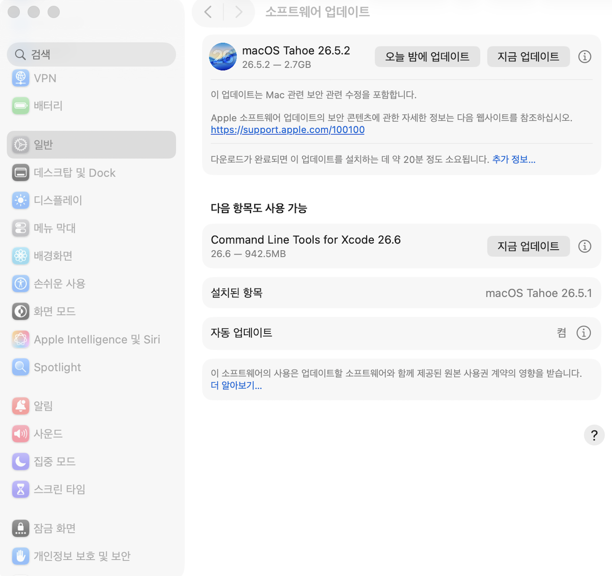
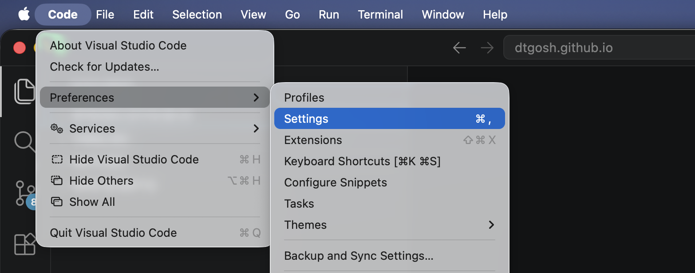
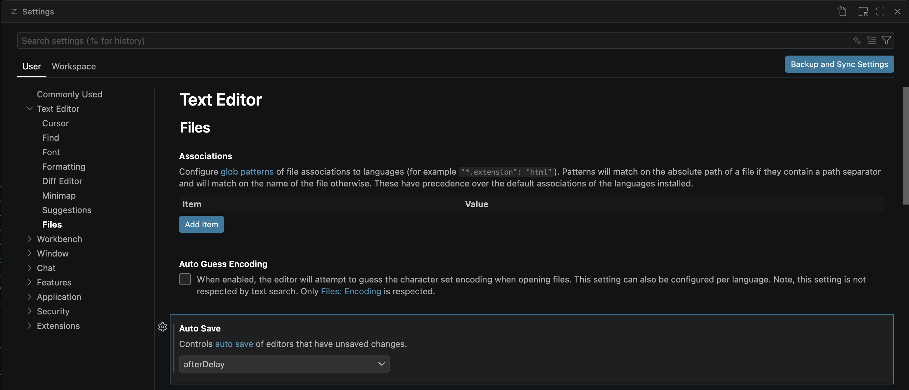
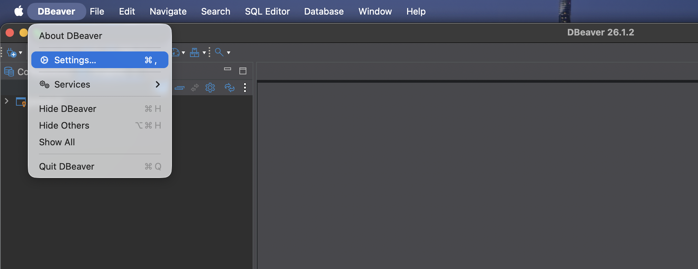
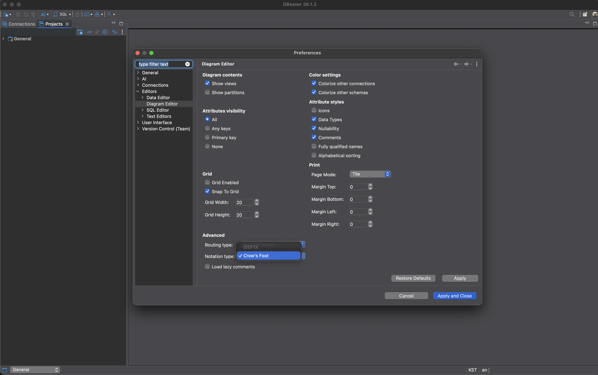
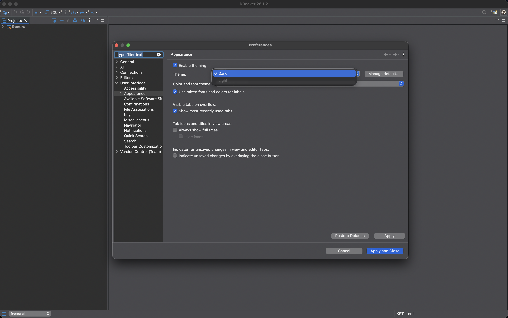

새 컴퓨터를 사거나 기존 컴퓨터를 초기화하면, 개발 작업을 위해 해 두었던 설정을 처음부터 다시 해야 한다. 이 글에서는 내가 그때마다 하는 설정을 정리했다.

macOS를 기준으로 썼다.

## 1. 앱 설치

먼저 아래 앱들을 설치한다.

- **[Chrome](https://www.google.com/chrome/)**: 웹 브라우저
- **[Visual Studio Code](https://code.visualstudio.com/)**: 코드 편집기
- **[DBeaver Community](https://dbeaver.io/download/)**: 데이터베이스 클라이언트
- **[Docker Desktop](https://www.docker.com/products/docker-desktop/)**: 컨테이너 실행 환경
- **Command Line Tools for Xcode**: Git과 컴파일러를 포함한 기본 개발 도구 모음
    - 터미널에서 아래 명령어로 설치한다.

        ```bash
        xcode-select --install
        ```

    - 업데이트는 시스템 설정의 `일반 > 소프트웨어 업데이트`에서 확인할 수 있다.
        
- **[Postman](https://www.postman.com/downloads/), [Bruno](https://www.usebruno.com/), [Hoppscotch](https://hoppscotch.io/) 중 하나**: API 요청을 보내고 응답을 확인하는 도구

아래 도구들은 필요할 때 설치한다.

- **[nvm](https://github.com/nvm-sh/nvm) 또는 [fnm](https://github.com/Schniz/fnm)**: Node.js 버전 관리 도구. Node.js로 개발할 때 설치한다.
- **[SDKMAN](https://sdkman.io/)**: JDK 버전 관리 도구. Java로 개발할 때 설치한다.
- **[pyenv](https://github.com/pyenv/pyenv)**: Python 버전 관리 도구. Python으로 개발할 때 설치한다.
- **[Homebrew](https://brew.sh/)**: macOS용 패키지 관리자. 필요해지는 순간이 오면 설치한다.

## 2. Git 설정

macOS에서는 Git이 Command Line Tools for Xcode에 포함되어 있어서 따로 설치하지 않아도 된다. 다른 OS를 쓴다면 [Git 설치 페이지](https://git-scm.com/install)에서 OS에 맞는 방법으로 설치한다.

설치가 끝나면 커밋에 기록될 이름과 이메일을 등록한다.

```bash
git config --global user.name "이름"
git config --global user.email "이메일"
```

등록한 정보는 아래 명령어로 확인할 수 있다.

```bash
git config --global --list
```

잘못 등록했다면 같은 명령어로 다시 등록하면 된다. 등록한 정보를 아예 지우고 싶을 때는 아래 명령어를 쓴다.

```bash
git config --unset --global user.name
git config --unset --global user.email
```

## 3. Visual Studio Code 설정

Visual Studio Code를 설치했다면 Auto Save를 켜 두는 것이 좋다. 켜지 않으면 파일을 고칠 때마다 직접 저장해야 한다.

1. 메뉴의 `Code > Preferences > Settings`로 설정을 연다. 단축키는 `⌘ ,`이다.

    

2. `User` 탭의 `Text Editor > Files`에서 `Auto Save`를 `afterDelay`로 바꾼다.

    

## 4. DBeaver Community 설정

DBeaver의 다이어그램 기능은 ERD를 만들어 주기 때문에, 데이터 구조를 파악할 때 정말 유용하다. 그런데 카디널리티 표기법의 기본값이 IDEF1X로 되어 있다. 아래와 같이 하면 Crow's Foot 표기법으로 바꿀 수 있다.

1. 메뉴의 `DBeaver > Settings...`로 설정을 연다. 단축키는 `⌘ ,`이다.

    

2. `Editors > Diagram Editor`에서 `Notation type`을 `Crow's Foot`으로 바꾸고 `Apply and Close`를 누른다.

    

같은 설정 창에서 DBeaver의 테마도 바꿀 수 있다. `User Interface > Appearance`의 `Theme`에서 원하는 테마를 고른다.


