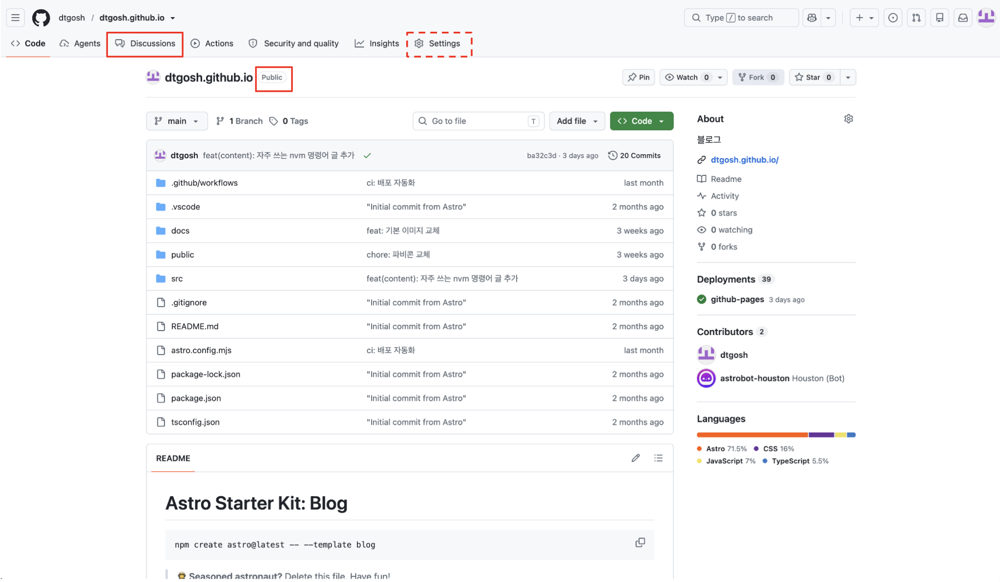
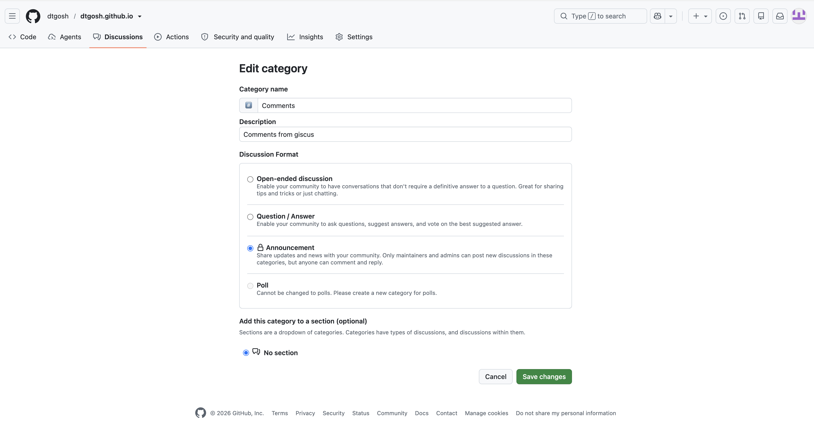
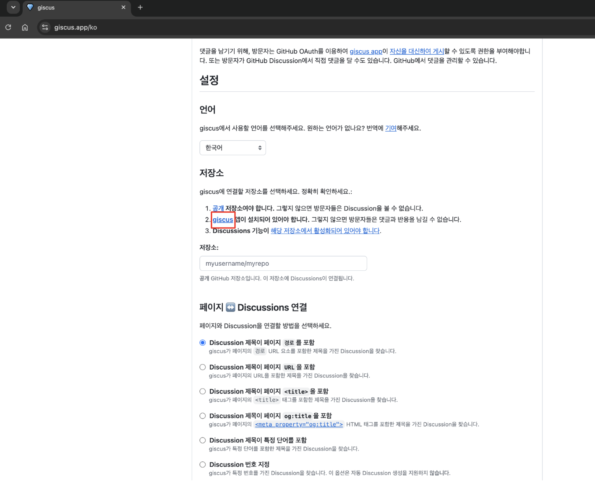
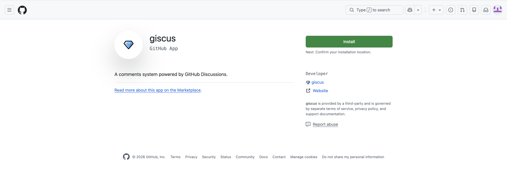
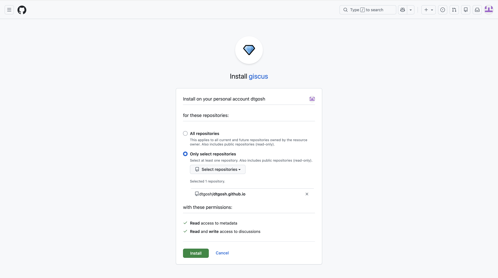
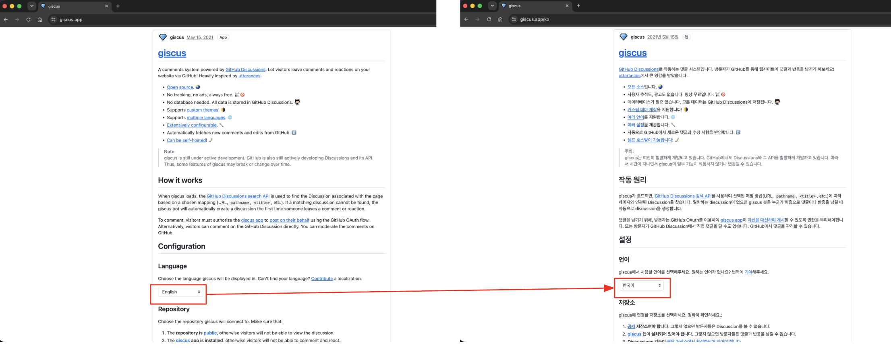
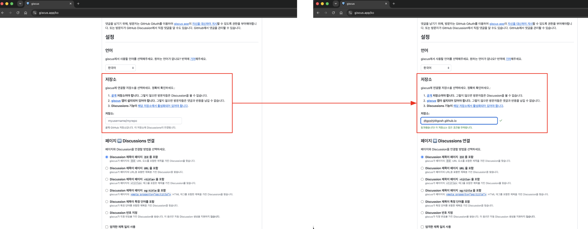
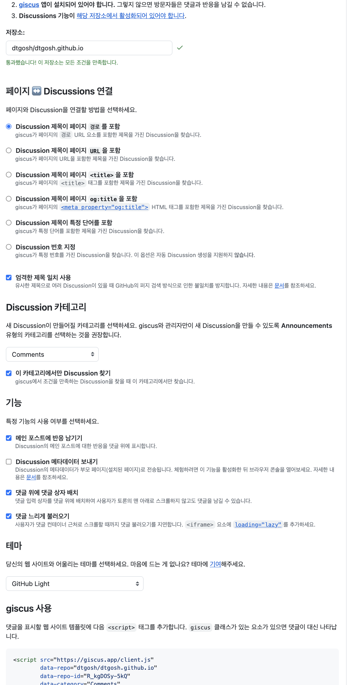
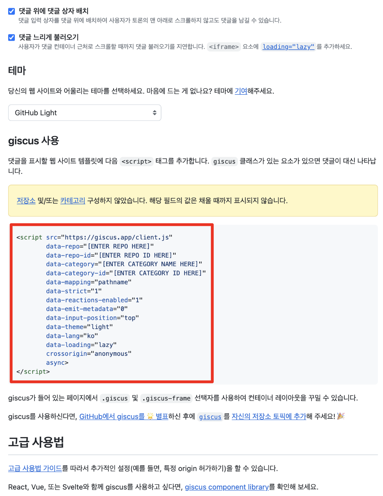

GitHub Pages로 블로그를 만들면 댓글 기능을 어떻게 추가할지 고민하게 된다. 댓글 기능 하나를 위해 회원가입과 로그인을 개발하고, DB와 서버까지 구축해 관리하기는 부담스럽기 때문이다. giscus를 쓰면 이 고민을 해결할 수 있다.

giscus는 GitHub Discussions를 기반으로 댓글 기능을 만들어 주는 오픈소스 프로젝트로, 광고가 없고 사용자를 추적하지도 않는다고 한다. 별도의 인프라를 구축하거나 로그인과 댓글 CRUD를 직접 구현할 필요도 없다. 카카오와 우아한형제들 같은 기업의 기술 블로그에서도 쓰고 있어, 충분히 검증된 도구라고 볼 수 있다.

이 글에서는 giscus로 댓글 기능을 만드는 과정을 설명한다.

## 1. GitHub 레포지토리 준비하기

1. 먼저 Discussions 기능이 활성화되어 있고, 공개 설정이 Public인 레포지토리를 준비한다. 설정이 되어 있지 않다면 레포지토리의 Settings에서 변경한다.
    

2. Discussions에서 댓글이 저장될 새 카테고리를 생성한다. 나는 이름을 `Comments`로 지었다. giscus와 관리자만 새 Discussion을 만들 수 있도록 **Announcements** 유형으로 생성하는 것을 권장한다.
    

3. 이제 giscus 앱을 설치한다. [giscus 홈페이지](https://giscus.app)에서 아래 이미지의 빨간 상자 부분을 클릭하거나, [https://github.com/apps/giscus](https://github.com/apps/giscus)로 이동한다.
    

4. 아래와 같은 페이지가 나오면 `Install` 버튼을 클릭한다.
    

5. 설치 권한은 모든 레포지토리가 아닌, 필요한 레포지토리 하나만 선택해서 허용해 준다. `Install` 버튼을 클릭하면 설치가 완료되고, GitHub에서의 준비는 모두 끝난다.
    

## 2. giscus 코드 생성하기

1. [giscus 홈페이지](https://giscus.app)에서 원하는 언어를 설정한다. 참고로 이 설정은 홈페이지의 언어뿐 아니라, 최종적으로 블로그에 추가될 댓글 위젯의 언어에도 적용된다.
    

2. 앞의 과정에서 준비한 레포지토리 정보를 입력하고 성공 메시지를 확인한다.
    

3. 나머지 옵션을 설정한다. 내가 고른 값과 이유는 다음과 같다.

	- **페이지 ↔ Discussions 연결**: `Discussion 제목이 페이지 경로를 포함`을 선택했다. 글마다 경로가 고유하고, 글 제목을 고쳐도 댓글이 그대로 연결된다.

    - **엄격한 제목 일치 사용**: 체크했다. GitHub의 검색은 비슷한 제목도 찾아 주기 때문에, 이 옵션을 끄면 경로가 비슷한 글끼리 댓글이 섞일 수 있다.

    - **Discussion 카테고리**: 앞에서 만든 `Comments`를 선택하고, `이 카테고리에서만 Discussion 찾기`도 체크했다. 다른 카테고리의 Discussion이 댓글로 잘못 연결되는 일을 막아 준다.

    - **기능**: `메인 포스트에 반응 남기기`, `댓글 위에 댓글 상자 배치`, `댓글 느리게 불러오기`를 체크했다. 댓글 상자를 위에 두면 댓글이 많아도 스크롤 없이 바로 쓸 수 있고, 느리게 불러오면 독자가 댓글 영역 근처까지 내려왔을 때만 위젯을 불러와서 첫 화면이 가벼워진다.

    - **테마**: 블로그 배경이 밝아서 `GitHub Light`를 선택했다.

    

4. 마지막으로 생성된 코드를 복사한다. 아래 이미지는 레포지토리를 입력하지 않고 찍어서 `[ENTER REPO HERE]` 같은 자리 표시와 경고가 보이지만, 실제로는 입력한 레포지토리와 카테고리 값이 채워져 나온다.
    

## 3. 블로그에 적용하기

이제 복사한 코드를 블로그에서 댓글을 표시할 위치에 붙여 넣으면 된다.

내 블로그는 Astro로 만들어서, 재사용하기 쉽게 `Comments` 컴포넌트로 분리했다. 대괄호로 표시한 네 값은 giscus 홈페이지가 채워 준 값을 그대로 쓰면 된다.

```astro
<!-- src/components/Comments.astro -->
<section class="comments" aria-label="댓글">
	<script
		is:inline
		src="https://giscus.app/client.js"
		data-repo="[ENTER REPO HERE]"
		data-repo-id="[ENTER REPO ID HERE]"
		data-category="[ENTER CATEGORY NAME HERE]"
		data-category-id="[ENTER CATEGORY ID HERE]"
		data-mapping="pathname"
		data-strict="1"
		data-reactions-enabled="1"
		data-emit-metadata="0"
		data-input-position="top"
		data-theme="light"
		data-lang="ko"
		data-loading="lazy"
		crossorigin="anonymous"
		async></script>
</section>

<style>
	.comments {
		width: 720px;
		max-width: calc(100% - 2em);
		margin: 2em auto 0;
	}
</style>
```

복사한 코드에서 달라진 부분은 `is:inline` 하나다. giscus 스크립트는 자신의 `<script>` 태그에 붙은 `data-*` 속성을 읽어서 설정을 가져오므로, 이 태그가 원본 그대로 HTML에 남아 있어야 한다. Astro는 `src` 외의 속성이 있는 `<script>`를 처리하지 않아서 `is:inline`이 없어도 동작하지만, 번들링하면 안 되는 스크립트라는 의도를 분명히 하려고 붙였다.

그리고 이 컴포넌트를 블로그 글 레이아웃의 본문 바로 아래에 넣었다. 이렇게 하면 모든 글에 댓글 창이 달린다.

```astro
---
// src/layouts/BlogPost.astro
import Comments from '../components/Comments.astro';
---

<main>
	<article>
		<!-- 글 제목과 본문 -->
		<slot />
	</article>
	<Comments />
</main>
```

## 4. 동작 확인하기

블로그를 배포하고 글을 열면 본문 아래에 댓글 창이 보인다. 이 글 아래에 있는 댓글 창이 바로 그 결과물이다.

글을 올릴 때마다 Discussion을 직접 만들 필요는 없다. 누군가 첫 댓글이나 반응을 남기면, giscus가 해당 글의 경로를 제목으로 하는 Discussion을 `Comments` 카테고리에 자동으로 만든다. 그 뒤로는 레포지토리의 Discussions 탭에서 댓글을 확인하고 관리할 수 있다.
