GitHub Pages로 블로그를 만들었다면, 댓글 기능을 어떻게 추가할지 고민이 됩니다.
댓글 기능 하나를 위해 회원가입·로그인을 직접 개발하고, DB와 서버 같은 인프라까지 구축해서 관리하는 것은 부담스럽기 때문인데요.
giscus가 이 고민을 해결해 줄 수 있습니다.

giscus는 GitHub Discussions를 기반으로 댓글 기능을 쉽게 추가할 수 있게 해주는 오픈소스 프로젝트입니다.
광고가 없고 사용자 추적도 하지 않습니다.
덕분에 별도의 인프라 구축 없이, 로그인이나 댓글 CRUD를 직접 구현하지 않고도 댓글 기능을 붙일 수 있습니다.

특히 이 블로그의 댓글 기능도 giscus로 만들었는데요.
이번 글에서는 giscus로 댓글 기능을 만드는 과정을 단계별로 설명하겠습니다.

### 1. GitHub Repository 준비

1. 먼저 Discussions 기능이 활성화되어 있고, 공개 설정이 Public인 Repository를 준비합니다. 설정이 되어 있지 않다면 Repository의 Settings에서 변경해 줍니다.
    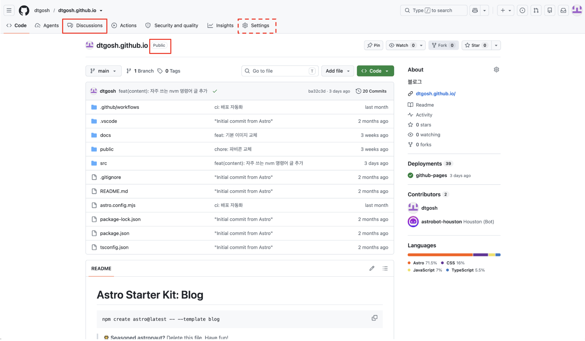

2. Discussions에서 댓글이 저장될 새 카테고리를 생성합니다. giscus와 관리자만 새 Discussion을 만들 수 있도록 **Announcements** 유형으로 생성하는 것을 권장합니다.
    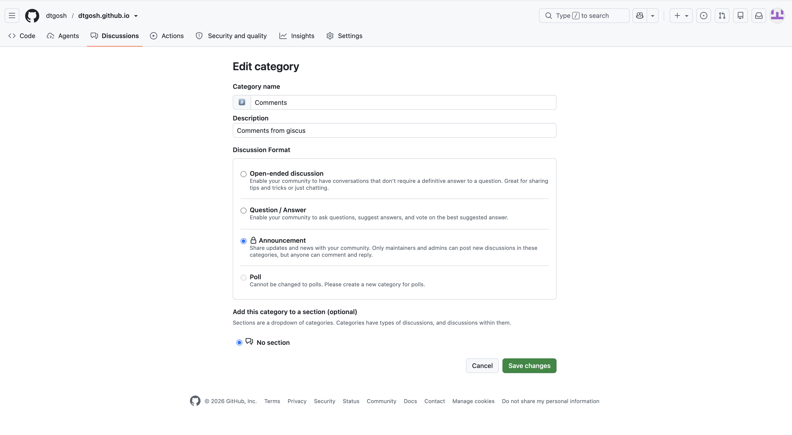

3. 이제 giscus 앱을 설치합니다. [giscus 홈페이지](https://giscus.app)에서 아래 이미지의 빨간 상자 부분을 클릭하거나, [https://github.com/apps/giscus](https://github.com/apps/giscus)로 이동합니다.
    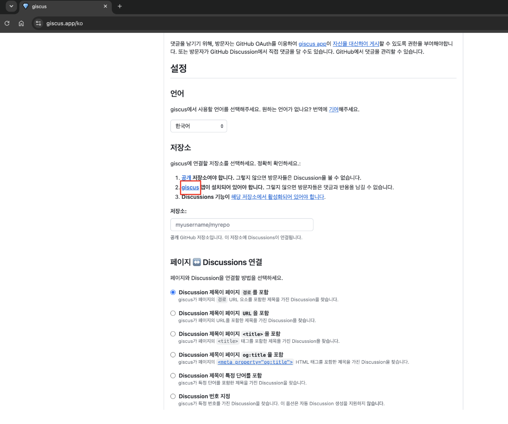

4. 아래와 같은 페이지가 나오면 `Install` 버튼을 클릭합니다.
    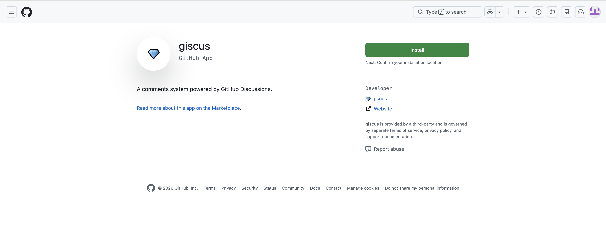

5. 설치 권한은 모든 레포지토리가 아닌, 필요한 레포지토리 하나만 선택해서 허용해 줍니다. `Install` 버튼을 클릭하면 설치가 완료되고, GitHub에서의 준비는 모두 끝납니다.
    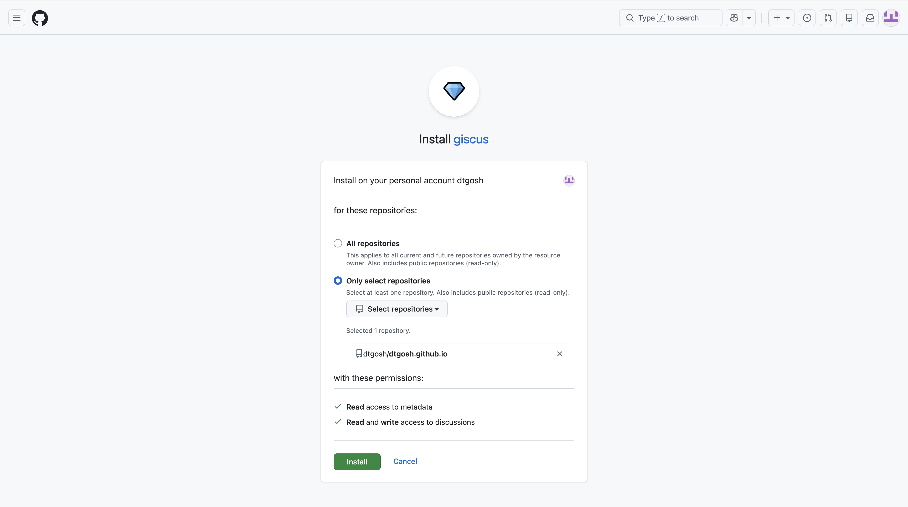

### 2. giscus 코드 생성하기

1. 먼저 [giscus 홈페이지](https://giscus.app)에 접속합니다.
    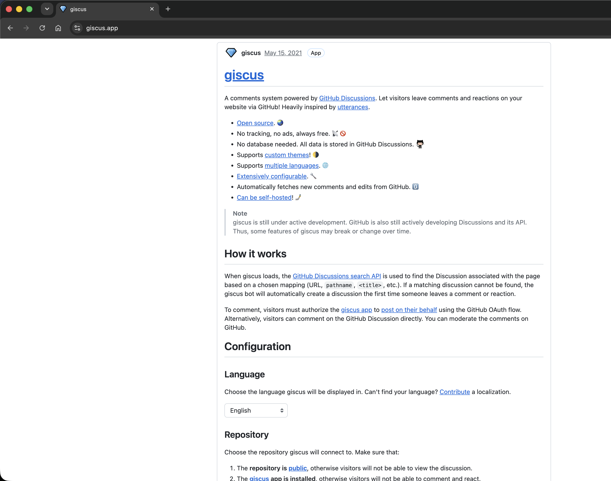

2. 원하는 언어를 설정합니다. 이 설정은 홈페이지의 언어뿐 아니라, 최종적으로 블로그에 추가될 댓글 위젯의 언어에도 적용됩니다.
    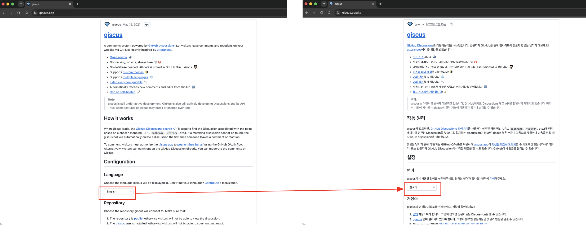

3. 앞의 과정에서 준비한 레포지토리 정보를 입력하고 성공 메시지를 확인합니다.
    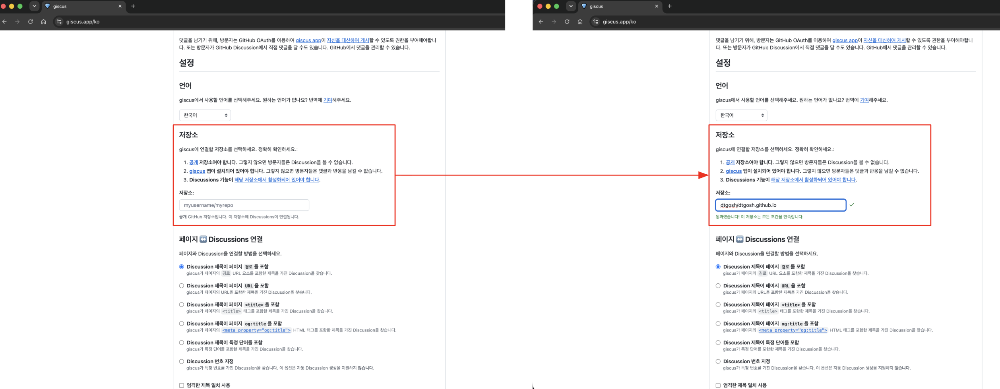

4. 나머지 옵션들을 아래와 같이 설정합니다.
    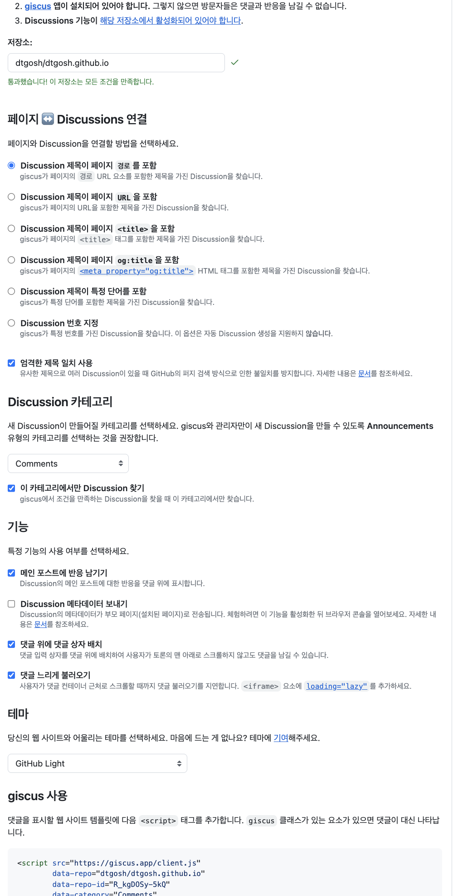

5. 마지막으로 생성된 코드를 복사합니다.
    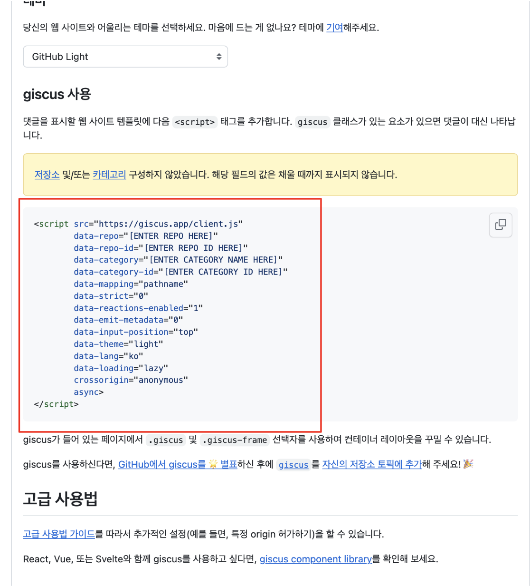

### 3. 블로그에 적용하기

이제 복사한 코드를 블로그 코드에 붙여넣으면 끝입니다!

참고로 제 블로그는 Astro로 만들어서, 재사용하기 쉽게 컴포넌트로 추가했습니다.
다만 Astro는 기본적으로 `<script>` 태그를 번들링하는데, giscus 스크립트는 외부에서 로드되어야 하므로 원본 그대로 HTML에 들어가야 합니다.
그래서 `is:inline` 지시어를 붙여서 번들링을 건너뛰도록 처리했습니다.
    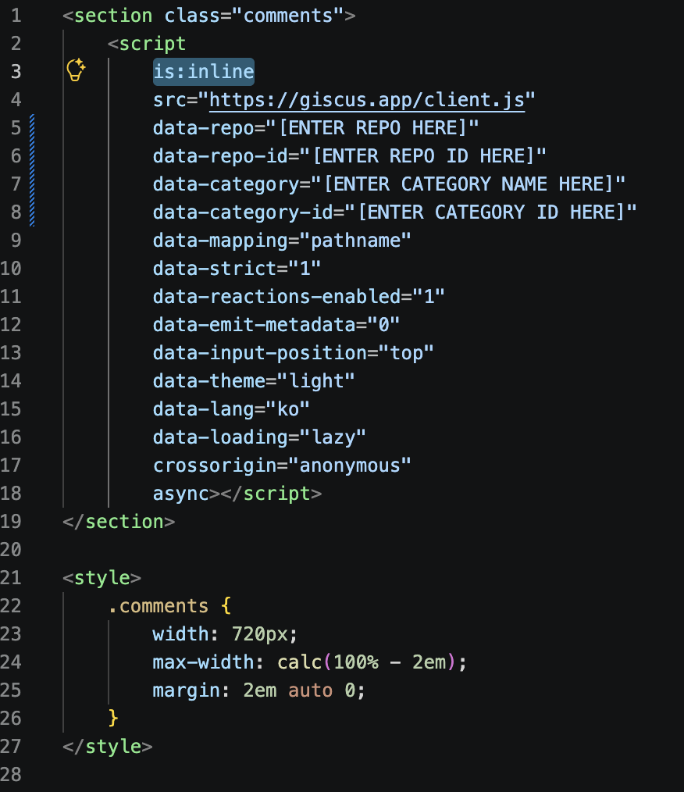
    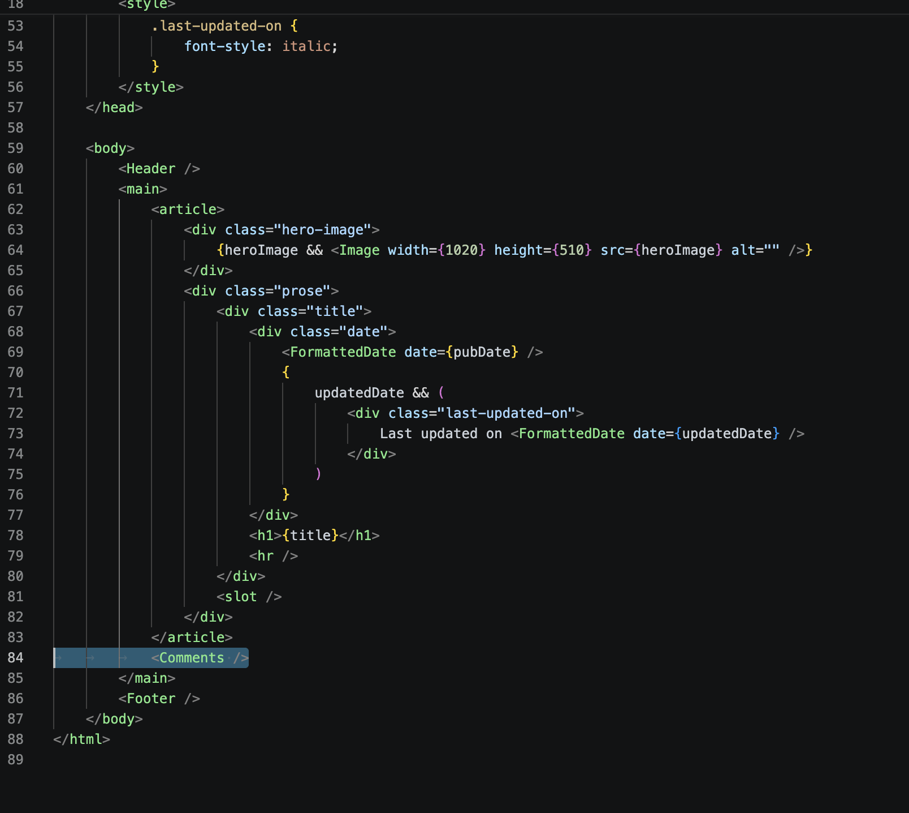

감사합니다!